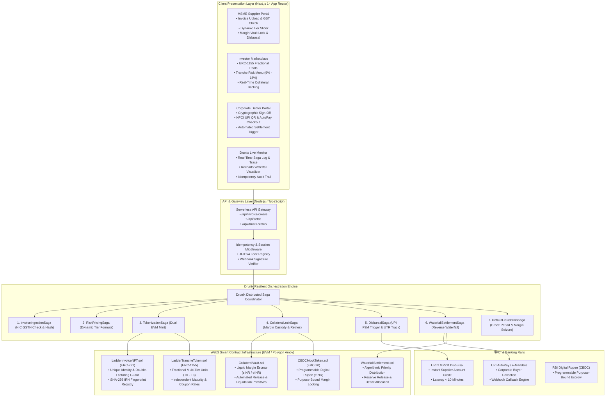
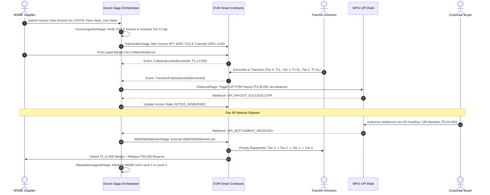

# LadderPay: Tiered, Collateral-Aware Invoice Financing Platform

[](https://opensource.org/licenses/MIT)
[](https://nextjs.org/)
[](https://soliditylang.org/)
[](https://ethereum.org/en/developers/docs/standards/tokens/)
[](https://www.npci.org.in/)
[](https://drunix.io/)

> **Institutional-Grade Real-World Asset (RWA) Tokenization & Working Capital Infrastructure for MSMEs**  
> *Cash on your invoice today. The more collateral you post, the more you unlock, and the less you pay.*

---

## 1. Executive Summary & Problem Landscape

Small and Medium Enterprises (MSMEs) form the backbone of the Indian economy, contributing over 30% of GDP and 45% of manufacturing output. However, Indian MSMEs are constrained by a **₹30+ lakh crore credit gap**, driven primarily by **60-to-90 day payment cycles** from large corporate buyers.

Traditional invoice discounting and factoring channels (including TReDS and commercial banks) suffer from fundamental structural limitations:
- **Binary Underwriting:** Financing is strictly all-or-nothing. Suppliers with unrated corporate buyers or lacking pristine audited track records are rejected outright.
- **Uniform Risk Blobbing:** All investors in a financed invoice bear identical risk regardless of their institutional risk mandate.
- **Collateral Rigidity:** Small enterprises possessing modest collateral cannot use it dynamically to reduce their borrowing costs.
- **High Operational Latency:** Manual verification and disconnected banking rails delay disbursals for days or weeks.

### The LadderPay Solution
**LadderPay** resolves this bottleneck through **Tiered, Collateral-Aware Real-World Asset (RWA) Tokenization**. By decomposing verified corporate invoices into discrete risk-priced tranches backed by a decentralized margin vault, LadderPay enables:
1. **Instant Uncollateralized Liquidity:** Small firms immediately access a capped, collateral-free cash advance (Tier 0).
2. **Dynamic Margin Unlocking:** Enterprises post fractional margin into an on-chain vault to unlock larger funding slices at progressively lower interest rates.
3. **Reverse Waterfall Settlement:** On invoice maturity, corporate repayments flow through an algorithmic repayment waterfall, prioritizing senior collateralized tranches first and protecting institutional capital.
4. **On-Chain Credit Progression:** Prompt repayments permanently upgrade the MSME's credit reputation tier on-chain, expanding future collateral-free limits.

---

## 2. Core Financial Architecture

```
                    INVOICE FACE VALUE: ₹5,00,000 (90-Day Tenure)
 ┌──────────────────────────────────────────────────────────────────────────────────┐
 │ Tier 0 (First 20%): ₹1,00,000  │ Collateral: None       │ Discount Rate: 18% APY │
 ├──────────────────────────────────────────────────────────────────────────────────┤
 │ Tier 1 (Next 30%):  ₹1,50,000  │ Collateral: 25% (₹37.5k)│ Discount Rate: 14% APY │
 ├──────────────────────────────────────────────────────────────────────────────────┤
 │ Tier 2 (Next 30%):  ₹1,50,000  │ Collateral: 50% (₹75.0k)│ Discount Rate: 11% APY │
 ├──────────────────────────────────────────────────────────────────────────────────┤
 │ Tier 3 (Next 10%):  ₹50,000    │ Collateral: 100%(₹50.0k)│ Discount Rate: 9% APY  │
 ├──────────────────────────────────────────────────────────────────────────────────┤
 │ Reserve (Last 10%): ₹50,000    │ Retained in Escrow     │ Released at Maturity   │
 └──────────────────────────────────────────────────────────────────────────────────┘
```

### The Three Pillars of LadderPay

#### A. The Dynamic Tier Ladder
Unlike conventional invoice discounting, the total advance is segmented into risk-graded tranches:
- **Tier 0 (Junior / Uncollateralized):** Provides immediate liquidity without collateral. Its cap is dynamically computed as:
  $$\text{Tier 0 Cap} = \min\Big(20\% \times \text{Invoice Face Value},\; \text{MSME Reputation Cap},\; \text{Buyer Exposure Limit}\Big)$$
  Offered at higher yields (e.g., 18% APY) to attract yield-seeking alternative credit investors who absorb first-loss risk.
- **Tiers 1, 2, and 3 (Senior / Collateral-Matched):** Higher slices unlock sequentially only as the supplier posts liquid margin (in INR, CBDC, or fixed deposit liens) into `CollateralVault.sol`. Posting margin substantially reduces borrowing costs from 18% down to 9% APY.
- **Statutory Reserve (10%):** Retained in smart escrow to cushion against reconciliation discrepancies and released to the supplier upon final buyer payment.

#### B. Reverse Waterfall Settlement Engine
When the corporate buyer settles on the maturity date (Day 90), capital is distributed strictly in **reverse risk order**:

$$\text{Buyer Repayment} \longrightarrow \mathbf{Tier\;3} \longrightarrow \mathbf{Tier\;2} \longrightarrow \mathbf{Tier\;1} \longrightarrow \mathbf{Tier\;0} \longrightarrow \mathbf{Reserve\;Release\;(MSME)}$$

- **Senior Tranches Repaid First:** Tier 3 (100% collateralized, lowest yield) is made whole first, followed by Tier 2, Tier 1, and lastly Tier 0.
- **First-Loss Absorption:** If the corporate buyer defaults or pays a partial sum, the junior tier absorbs the shortfall while the smart contract automatically liquidates the MSME's margin in `CollateralVault.sol` to ensure senior tranche investors remain 100% whole.

#### C. The Reputation Ladder
Every clean, on-time settlement upgrades the MSME's on-chain credit level:
- **Level 1 (New Supplier):** ₹1,00,000 collateral-free Tier 0 limit.
- **Level 2 (Clean Track Record):** ₹2,50,000 collateral-free Tier 0 limit.
- **Level 3+ (Established Supplier):** ₹5,00,000+ collateral-free limit.
Collateral ceases to be a permanent barrier to capital, transforming historical payment integrity into an uncollateralized credit asset.

---

## 3. End-to-End System Architecture



---

## 4. Smart Contract Specifications

All smart contracts are developed in Solidity `^0.8.20` with strict adherence to EVM standards and security best practices:

| Contract | Standard | Key Responsibilities |
| :--- | :--- | :--- |
| [`LadderInvoiceNFT.sol`](file:///C:/Users/Abhid/.gemini/antigravity/scratch/ladderpay/contracts/LadderInvoiceNFT.sol) | **ERC-721** | Minted upon invoice verification. Stores cryptographic SHA-256 fingerprint (`invoiceHash = keccak256(GSTIN, IRN, BuyerPAN, Value, DueDate)`). Implements an immutable global registry blocking identical invoices from multi-platform double-financing. |
| [`LadderTrancheToken.sol`](file:///C:/Users/Abhid/.gemini/antigravity/scratch/ladderpay/contracts/LadderTrancheToken.sol) | **ERC-1155** | Represents fractional units of risk slices. Token ID encoding: `(invoiceId << 8) | tierIndex`. Supports fractional investor subscriptions starting at ₹10,000 per tranche. |
| [`CollateralVault.sol`](file:///C:/Users/Abhid/.gemini/antigravity/scratch/ladderpay/contracts/CollateralVault.sol) | **Custody** | Holds supplier margin deposits. Locks capital for the duration of the 90-day invoice. Enforces atomic unlock on clean settlement or automated liquidation on buyer default. |
| [`WaterfallSettlement.sol`](file:///C:/Users/Abhid/.gemini/antigravity/scratch/ladderpay/contracts/WaterfallSettlement.sol) | **Risk Engine** | Algorithmic reverse waterfall execution contract. Distributes buyer collections from Tier 3 down to Tier 0, handles deficit allocation, and triggers collateral release or seizure. |
| [`CBDCMockToken.sol`](file:///C:/Users/Abhid/.gemini/antigravity/scratch/ladderpay/contracts/CBDCMockToken.sol) | **ERC-20** | Programmable Digital Rupee (`eINR`) implementation featuring purpose-bound margin escrow primitives (`lockMargin`, `releaseMargin`, `liquidateMargin`). |

---

## 5. Drunix Resilient Orchestration Engine

Bridging off-chain fiat banking APIs (NPCI UPI) with on-chain smart contracts requires fault-tolerant distributed transaction coordination. Drunix executes every multi-system interaction as an **idempotent Saga** with state recovery:



### Drunix Architectural Guarantees
1. **Idempotency Invariant:** Every outbound transaction carries an `X-Idempotency-Key` (`UUIDv4`). Duplicate network deliveries or retried webhook callbacks never result in duplicate financial disbursals.
2. **Dual-State Reconciliation:** Maintains continuous bidirectional consistency between off-chain banking UTRs and on-chain EVM block receipts.
3. **Automated Compensation & Rollback:** If an investor subscription fails or network congestion prevents finalization, Drunix executes compensating sagas to unlock supplier margin automatically.
4. **Resilient Retry Semantics:** Network dropouts or RPC rate limits trigger exponential backoff retry loops with zero state corruption.

---

## 6. NPCI Rails Integration

LadderPay leverages NPCI's digital payment ecosystem to ensure frictionless, production-feasible settlement:

- **UPI 2.0 P2M Disbursal:** Upon tranche subscription completion, proceeds are disbursed directly to the supplier's registered Virtual Payment Address (VPA) in **under 10 minutes**, eliminating traditional 3-to-5 day banking float delays.
- **UPI AutoPay & e-Mandate Collections:** At invoice verification, the corporate buyer authorizes a recurring e-mandate. On Day 90 maturity, the settlement amount is automatically collected through NPCI rails.
- **Digital Rupee (CBDC) Margin Escrow:** Supports programmable Digital Rupee (`eINR`) contracts, enabling purpose-bound margin locking where tokens cannot be spent or transferred until smart contract settlement conditions are met.

---

## 7. Risk Management & Regulatory Defense

| Risk Vector | Platform Mitigation | Regulatory Standard |
| :--- | :--- | :--- |
| **Duplicate / Multi-Platform Financing** | SHA-256 fingerprinting of NIC GST e-invoice IRN registered permanently in `LadderInvoiceNFT.sol`. Reverts identical tokenization attempts across all lenders. | *Factoring Regulation Act, 2011* (Section 19 - Registration of Assignments) |
| **Corporate Buyer Default / Shortfall** | **72-Hour Statutory Grace Period:** If payment is delayed on Day 90, a grace period protocol initiates. Upon Day 93 expiration without settlement, the smart contract automatically seizes supplier margin to reimburse senior tranche investors. | *RBI Master Directions - Non-Banking Financial Company - Factoring* |
| **Regulatory Token Classification** | Tokens function strictly as **cryptographic evidentiary certificates of fractional invoice assignment**. All monetary value transfer, custody, and settlement occur in Indian Rupees (INR) through licensed NBFC-Factor banking partners and NPCI rails. | *RBI Regulatory Sandbox for Digital Lending & MSME Financing* |
| **First-Loss Haircut Transparency** | Junior Tier 0 investors earn an 18% APY coupon specifically to absorb initial credit variance. Senior tranches remain over-collateralized by up to 100% margin. | *Basel III Securitisation Framework (Tranche Seniority Standards)* |

---

## 8. Technology Stack

```
Frontend:          Next.js 14 (App Router) • React 18 • TypeScript • Tailwind CSS
Data Visualization:Recharts (Stacked Waterfall & Yield Visualizations) • Lucide React
Smart Contracts:   Solidity 0.8.20 • OpenZeppelin Contracts • Hardhat Development Suite
Blockchain:        Polygon Amoy Testnet (EVM) • Ethereum Sepolia (Secondary Testnet)
Orchestration:     Drunix Resilient State Machine • Custom Saga Coordination Hooks
Backend Engine:    Node.js • Express • CORS • Docker
Deployment:        Vercel (Frontend / Serverless API) • Render (Standalone Microservices)
```

---

## 9. Repository Layout

```
ladderpay/
├── app/                          # Next.js 14 Fullstack Application
│   ├── api/                      # Serverless API Endpoints
│   │   ├── drunix-status/        # Drunix orchestrator telemetry & health check
│   │   ├── invoice/create/       # GST verification & dynamic tier cap calculator
│   │   └── settle/               # Reverse waterfall distribution processor
│   ├── components/               # Production UI Components
│   │   ├── BuyerPortal.tsx       # Corporate debtor verification & UPI checkout
│   │   ├── DefaultSimulatorModal.tsx # 72h grace period & margin liquidation engine
│   │   ├── DrunixVisualizer.tsx  # Real-time saga timeline & idempotency monitor
│   │   ├── InvestorMarketplace.tsx# ERC-1155 fractional tranche investment pool
│   │   ├── InvoiceUploadForm.tsx # Multi-step invoice upload & IRN signing pipeline
│   │   ├── MSMEDashboard.tsx     # Dynamic Tier Ladder & instant UPI advance tracker
│   │   ├── Navbar.tsx            # Navigation, status indicators & mobile drawer
│   │   └── WaterfallChart.tsx    # Recharts reverse waterfall distribution chart
│   ├── globals.css               # Modern fintech styling & glassmorphism utilities
│   ├── layout.tsx                # App root metadata & layout shell
│   └── page.tsx                  # Master reactive application orchestrator
├── backend/                      # Standalone Drunix Webhook Microservice
│   ├── Dockerfile                # Production container definition
│   ├── package.json              # Express server dependencies
│   └── server.js                 # Drunix webhook handler & status server
├── contracts/                    # Solidity 0.8.20 Smart Contracts
│   ├── CBDCMockToken.sol         # Programmable Digital Rupee (eINR) contract
│   ├── CollateralVault.sol       # Margin custody & liquidation contract
│   ├── LadderInvoiceNFT.sol      # ERC-721 invoice identity contract
│   ├── LadderTrancheToken.sol    # ERC-1155 fractional tranche token contract
│   └── WaterfallSettlement.sol   # Reverse waterfall priority repayment contract
├── lib/                          # Core Utilities & State Machine
│   ├── store.ts                  # Reactive invoice state & factory algorithms
│   ├── types.ts                  # Shared TypeScript domain definitions
│   ├── useDrunixSaga.ts          # Drunix saga orchestration hook & retry simulator
│   └── web3.ts                   # EVM testnet RPCs & contract address bindings
├── scripts/
│   └── deploy.js                 # Automated Hardhat multi-contract deployment script
├── hardhat.config.js             # Solidity compiler & network configurations
├── next.config.js                # Next.js compilation settings
├── package.json                  # Root workspace dependencies
├── render.yaml                   # 1-Click Render Cloud Blueprint
├── tailwind.config.ts            # Fintech design system token configuration
├── tsconfig.json                 # TypeScript compiler configuration
└── vercel.json                   # Vercel deployment configuration
```

---

## 10. Getting Started & Development

### Prerequisites
- Node.js `>= 18.17.0`
- npm `>= 9.0.0` or yarn / pnpm

### Local Installation
```bash
# Clone repository
git clone https://github.com/<YOUR_ORGANIZATION>/ladderpay.git
cd ladderpay

# Install dependencies
npm install

# Start local Next.js development server
npm run dev
```

Open [http://localhost:3000](http://localhost:3000) in your browser.

### Building for Production
```bash
# Build optimized production bundle
npm run build

# Start production server
npm start
```

### Smart Contract Compilation & Deployment
```bash
# Compile Solidity contracts
npx hardhat compile

# Deploy to Polygon Amoy Testnet
npx hardhat run scripts/deploy.js --network polygonAmoy
```

---

## 11. Cloud Deployment Configuration

### Vercel Deployment (Frontend & Serverless API)
LadderPay is zero-config ready for Vercel:
1. Connect your GitHub repository to Vercel.
2. Select **Next.js** framework preset with root directory `./`.
3. Set optional environment variables:
   ```env
   NEXT_PUBLIC_INVOICE_NFT_ADDRESS="0x71C67Ea4e98f79B8C5F6F3Eb03f7a17C0C7257A6"
   NEXT_PUBLIC_TRANCHE_TOKEN_ADDRESS="0x98A5B7b6a48f79B8C5F6F3Eb03f7a17C0C729112"
   NEXT_PUBLIC_COLLATERAL_VAULT_ADDRESS="0x44E67Ea4e98f79B8C5F6F3Eb03f7a17C0C721098"
   NEXT_PUBLIC_WATERFALL_ADDRESS="0x12F67Ea4e98f79B8C5F6F3Eb03f7a17C0C728876"
   NEXT_PUBLIC_CBDC_TOKEN_ADDRESS="0x55B67Ea4e98f79B8C5F6F3Eb03f7a17C0C723344"
   ```
4. Deploy.

### Render Deployment (Optional Standalone Microservice)
Use the included [`render.yaml`](file:///C:/Users/Abhid/.gemini/antigravity/scratch/ladderpay/render.yaml) blueprint to deploy the standalone Drunix orchestrator microservice on Render Free Web Service.

---

## 12. License & Acknowledgements

This project is licensed under the **MIT License** — see the [LICENSE](LICENSE) file for details.

Developed for the **Drunix + NPCI Hackathon** (*Track C: Real Asset Tokenization*), recognizing the potential of combining decentralized state machines with sovereign digital payment rails to solve the MSME working capital challenge.
